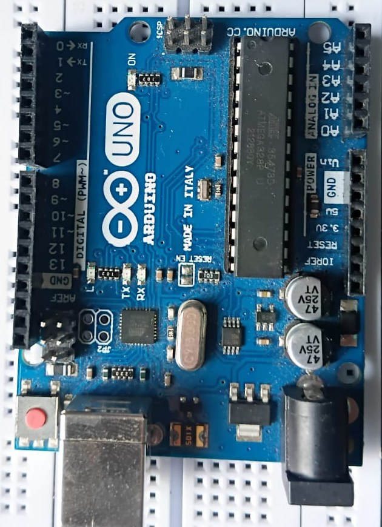
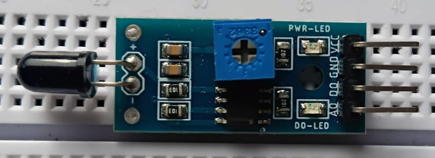
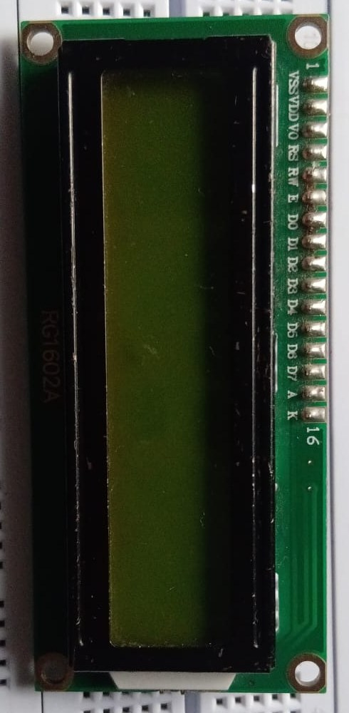
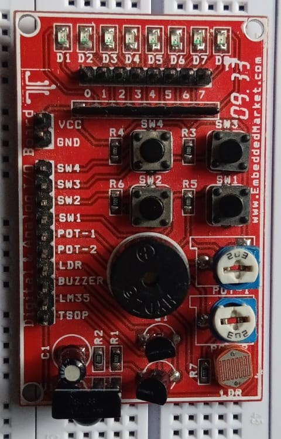
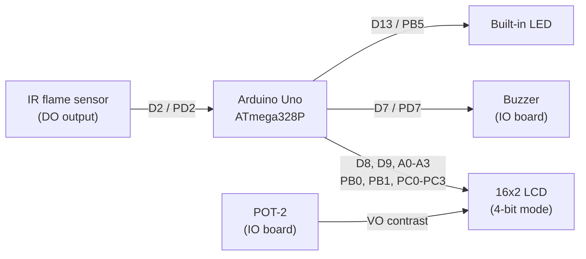
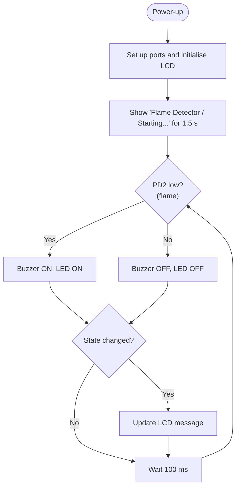

# 🔥 Flame Sensor Fire Alarm (Arduino Uno / ATmega328P)


A bare-metal embedded fire detection system. An infrared flame sensor is polled by an **ATmega328P** (Arduino Uno); when a flame is detected the buzzer sounds, the on-board LED turns on and a warning shows on a 16x2 LCD. Otherwise the LCD shows that the system is safe.

It is written two ways: **pure AVR C** with no Arduino libraries (direct register access, hand-written 4-bit LCD driver), and an **Arduino sketch** using `LiquidCrystal`. The **same AVR C file** builds in two toolchains:

| Toolchain | Host OS | Compiler | Upload |
|---|---|---|---|
| **MPLAB X IDE** | macOS | XC8 | `avrdude` (post-build step) |
| **Microchip Studio 7** | Windows | AVR/GNU C (`avr-gcc`) | From the IDE |

> 🎓 Academic project: School of Electronics, Devi Ahilya Vishwavidyalaya, Indore. See [Team & Credits](#team--credits).

---

## Table of contents

- [Features](#features)
- [Hardware](#hardware)
- [Block diagram and program flow](#block-diagram-and-program-flow)
- [Connections](#connections)
- [How it works](#how-it-works)
- [Build and upload](#build-and-upload)
- [Configuration](#configuration)
- [Troubleshooting](#troubleshooting)
- [Repository structure](#repository-structure)
- [Project reports](#project-reports)
- [Contributing](#contributing)
- [Safety](#safety)
- [Team & Credits](#team--credits)
- [License](#license)

---

## Features

- Flame detection with a response time of about **100 ms** (polled every 100 ms).
- **Audible** (buzzer), **visual** (LED) and **text** (LCD) alarm.
- LCD driven in **4-bit mode** with its own small driver: only 6 pins used (RS, E, D4 to D7).
- The LCD is rewritten **only when the state changes**, so there is no flicker.
- Small code size: about **0.8 KB of flash** (781 bytes in the MPLAB X debug build).
- No Arduino core or libraries: direct `DDRx` / `PORTx` / `PINx` register access.

## Hardware

| Part | Notes |
|---|---|
| Arduino Uno (ATmega328P, 16 MHz) | Microcontroller board |
| IR flame sensor module | Digital output `DO` (low = flame) |
| EmbeddedMarket Digital & Analog IO board | Onboard buzzer, `POT-2` used for LCD contrast (a standalone buzzer also works) |
| 16x2 LCD (`RG1602A`, HD44780, 16-pin parallel) | 4-bit mode |
| 10 kΩ potentiometer *(or IO board `POT-2`)* | LCD contrast on `VO` |
| 220 Ω resistor | LCD backlight (`A`) |
| Jumper wires, USB cable | |

<table>
  <tr>
    <td align="center"><br><sub>Arduino Uno</sub></td>
    <td align="center"><br><sub>IR flame sensor module</sub></td>
    <td align="center"><br><sub>16x2 LCD (RG1602A)</sub></td>
    <td align="center"><br><sub>EmbeddedMarket IO board</sub></td>
  </tr>
</table>

<!--
Add a photo or GIF of the finished setup here, for example:

-->

## Block diagram and program flow





## Connections

| Part | Pin | Arduino Uno | ATmega328P port |
|---|---|---|---|
| **Flame sensor** | `VCC` / `GND` | `5V` / `GND` | Power |
| **Flame sensor** | `DO` | `D2` | `PD2` (internal pull-up enabled) |
| **IO board** | `5V` / `GND` | `5V` / `GND` | Power |
| **IO board buzzer** | `BUZZER` input | `D7` | `PD7` |
| **Built-in LED** | `L` | `D13` | `PB5` |
| **LCD** | `VSS`, `RW`, `K` | `GND` | Ground |
| **LCD** | `VDD` | `5V` | Power |
| **LCD** | `V0` (contrast) | IO board `POT-2` (or middle pin of a 10 kΩ pot) | Contrast voltage |
| **LCD** | `RS` | `D8` | `PB0` |
| **LCD** | `E` | `D9` | `PB1` |
| **LCD** | `D4` / `D5` / `D6` / `D7` | `A0` / `A1` / `A2` / `A3` | `PC0` / `PC1` / `PC2` / `PC3` |
| **LCD** | `A` (backlight +) | `5V` through a 220 Ω resistor | Backlight `+` |

> **Notes**
> - LCD pins `D0` to `D3` are **not connected** (4-bit mode).
> - All `GND` connections must be common.
> - If you use the EmbeddedMarket IO board, **remove the jumpers from its LED header** so `D2` and `D7` stay free.
> - `D0` / `D1` are the Uno's USB serial pins. Keep them unconnected while uploading.

## How it works

The flame sensor's `DO` pin goes **LOW** when infrared light from a flame is detected. The microcontroller polls this pin every 100 ms.

| State | LCD line 1 | LCD line 2 | Buzzer (`PD7`) / LED (`PB5`) |
|---|---|---|---|
| **Power-up (1.5 s)** | `Flame Detector` | `Starting...` | Off |
| **Safe** (`DO` = HIGH) | `System: SAFE` | `No Fire Detected` | Off |
| **Fire** (`DO` = LOW) | `FIRE DETECTED!!` | `Move to safety!` | On |

The LCD is updated only when the state changes (`fire != lastState`), which prevents screen flicker.

The source is a single file: [`avr/flame_sensor_lcd/main.c`](avr/flame_sensor_lcd/main.c).

## Build and upload

### 1. MPLAB X IDE (macOS with XC8 and `avrdude`)

1. Install `avrdude` once with Homebrew (`brew install avrdude`), and check your Arduino port name with `ls /dev/cu.usb*` (for example `/dev/cu.usbmodem1201`).
2. Create a new **ATmega328P** project in MPLAB X using the **XC8** compiler and add `avr/flame_sensor_lcd/main.c`.
3. Open **Project Properties > Conf: default > Building**, tick **Execute this line after build**, and enter (replace `/dev/cu.usbmodem1201` with your port):

   ```bash
   /opt/homebrew/bin/avrdude -p m328p -c arduino -P /dev/cu.usbmodem1201 -b 115200 -U flash:w:${ImagePath}:e
   ```

   *(If you flash a production `.hex` build instead of the debug `.elf`, change `:e` at the end to `:i`.)*
4. Click **Build Main Project**. MPLAB compiles the code and `avrdude` flashes the Uno automatically. The output ends with `avrdude done. Thank you.`

### 2. Microchip Studio 7 (Windows)

1. Open Microchip Studio and create a new project: **File > New > Project > C/C++ > GCC C Executable Project**.
2. Click **Next**, search for and select **ATmega328P** as the target device, and create the project.
3. Paste the code from `avr/flame_sensor_lcd/main.c` into `main.c` and save (**Ctrl + S**).
4. Compile with **Build > Build Solution** (**F7**).
5. Connect the Arduino Uno by USB, go to **Tools** in the top menu, select the configured **Programmer / Arduino** external tool, and upload the compiled program to the board.

### 3. Arduino IDE (alternative sketch)

1. Open `arduino/flame_sensor_lcd_parallel_arduino/flame_sensor_lcd_parallel_arduino.ino`.
2. Select **Arduino Uno** and the correct port, then click Upload.

The wiring is identical to the table above.

## Demo

<!-- Upload demo.mp4 via GitHub's web editor/issue drag-and-drop, or keep it in the repo and link it: -->
[Watch the demo video](docs/videos/demo.mp4)

- [Demo 3: what this video shows](docs/videos/demo2.mp4)

## Configuration

| What | Where in `main.c` | Default |
|---|---|---|
| CPU clock | `#define F_CPU` | `16000000UL` (Arduino Uno) |
| Polling interval | `_delay_ms(100)` at the end of the main loop | 100 ms |
| Start-up message time | `_delay_ms(1500)` before the loop | 1.5 s |
| Buzzer polarity | `BUZZER_ON()` / `BUZZER_OFF()` macros | Active-HIGH |
| LCD pins | `LCD_RS_*`, `LCD_E_*` macros and `PORTC` nibble | RS = PB0, E = PB1, D4 to D7 = PC0 to PC3 |

## Troubleshooting

- **Blank LCD or dark boxes:** adjust the contrast potentiometer (`POT-2`) and check that `RW` is wired to `GND`.
- **Buzzer reversed (on when safe):** if your buzzer is active-LOW (the Microchip Studio / Windows setup used one); swap the `BUZZER_ON()` and `BUZZER_OFF()` macros in `main.c`.
- **Upload fails / port busy:** make sure no wires are connected to `D0` (RX) or `D1` (TX) during flashing, and close any open terminal or serial windows.
- **No detection or false triggers:** turn the blue sensitivity potentiometer on the flame sensor module to tune its infrared threshold. Direct sunlight and some lamps give off infrared and can trigger the sensor.

## Repository structure

```text
flame-sensor-fire-alarm/
├── avr/
│   └── flame_sensor_lcd/
│       └── main.c              # the firmware (single source file)
├── arduino/
│   └── flame_sensor_lcd_parallel_arduino/
│       └── flame_sensor_lcd_parallel_arduino.ino   # LiquidCrystal version
├── demo.mp4
├── docs/
│   ├── Flame_Detection_Report_MPLAB_X.pdf
│   ├── Flame_Detection_Report_Microchip_Studio.pdf
│   └── images/                 # component photos used in this README
├── .github/
│   ├── ISSUE_TEMPLATE/bug_report.md
│   └── pull_request_template.md
├── CONTRIBUTING.md
├── LICENSE
├── .gitignore
└── README.md
```

## Project reports

The full project reports (components, circuit, software design, build steps and results) are in [`docs/`](docs):

- [Report: MPLAB X IDE version](docs/Flame_Detection_Report_MPLAB_X.pdf)
- [Report: Microchip Studio version](docs/Flame_Detection_Report_Microchip_Studio.pdf)

## Contributing

Teammates and contributors are welcome. Please read [CONTRIBUTING.md](CONTRIBUTING.md) first: use a branch for each change, keep the code style of `main.c`, and open a pull request.

## Safety

This is an academic learning prototype. **Do not rely on it as a certified life-safety fire alarm.**

## Team & Credits

| Name | Role |
|---|---|
| **Anuva Bhagtya** | Bare-Metal AVR C, Hardware Integration & **MPLAB X (macOS)** Toolchain |
| **Shweta Awasthi** | Bare-Metal AVR C, Hardware Integration & **Microchip Studio (Windows)** Toolchain |
| **Muskan Tomar** | Hardware Integration, Testing & **Microchip Studio (Windows)** Toolchain |
| **Aastha Tripathi** | Hardware Integration, Testing & **Microchip Studio (Windows)** Toolchain |

**Presented to:** Dr. Rameez Raja Chowdhary
**Institution:** School of Electronics, Devi Ahilya Vishwavidyalaya, Indore (M.Tech. Electronics, Sem VII, Batch 2023–2028)

## License

Released under the [MIT License](LICENSE).
